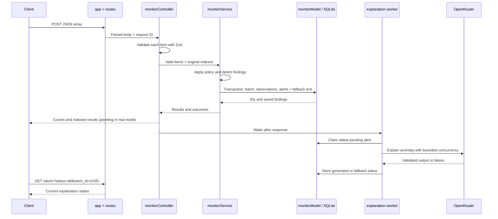

# Developer walkthrough: one monitoring batch end to end

For the dashboard, start the backend as described below and run `npm run dev` from `frontend/`. Open `http://127.0.0.1:5173`. `src/pages/DashboardPage.jsx` loads and filters alerts through `src/services/api.js`; `src/components/SubmitDialog.jsx` sends batches; `src/components/AlertDialog.jsx` shows the stored evidence and resolves alerts. The local Vite proxy forwards `/monitor`, `/alerts`, and `/health` to the backend. Frontend tests use a stubbed API client, while the live UI uses real backend responses.

This backend uses a small MVC layout. There is no HTML view: the HTTP JSON response is the view. The controllers handle HTTP, the model handles SQLite, and services hold the monitoring rules and explanation workflow.

| File | Job |
| --- | --- |
| `src/server.js` | Load config, open the database, listen, and shut down |
| `src/app.js` | Express middleware: request ID, logs, CORS, JSON limit, and errors |
| `src/routes.js` | Map URLs to controllers; perform the SQLite health check |
| `src/controllers/monitorController.js` | Validate the batch and shape the POST response |
| `src/controllers/alertController.js` | Validate filters and shape alert responses |
| `src/services/monitorService.js` | Apply policy and save findings with an initial explanation state |
| `src/services/detection.js` | Pure anomaly rules and factual fallback text |
| `src/services/explanation.js` | OpenAI SDK request to OpenRouter, output validation, timeout, and concurrency |
| `src/services/explanationWorker.js` | Claim stored pending alerts and update their explanations after POST |
| `src/models/monitorModel.js` | Migrations, transactions, and parameterized SQLite queries |
| `src/validation.js` | Zod schemas for observations and alert filters |
| `migrations/001_initial.sql`, `002_background_explanations.sql` | Tables, indexes, and worker claim fields |

## Run it locally

Use Node.js 24 and run from the repository root. The default `.env.example` uses `fallback` mode, so no paid API call is needed.

```powershell
Copy-Item .env.example .env
npm install
node --env-file=.env src/migrate.js
node --env-file=.env src/server.js
```

In a second terminal:

```powershell
$body = Get-Content .\samples\assessment.json -Raw
$batch = Invoke-RestMethod http://127.0.0.1:3000/monitor -Method Post -ContentType application/json -Body $body
$batch | ConvertTo-Json -Depth 8
$id = $batch.results[1].alert_id
Invoke-RestMethod "http://127.0.0.1:3000/alerts/$id" | ConvertTo-Json -Depth 8
Invoke-RestMethod "http://127.0.0.1:3000/alerts/$id/resolve" -Method Patch
Invoke-RestMethod http://127.0.0.1:3000/alerts
```

The sample has a healthy `PatientDataAPI` observation and an anomalous `AppointmentAPI` observation. The first result is `healthy`. The second contains one alert with `SERVER_FAILURE`, `SLOW_RESPONSE`, and `UNEXPECTED_EMPTY_RESULT`. It is `critical` because the server failure is critical. With the default fallback mode, `ai_summary` is `null`, `explanation_status` is `fallback`, and `fallback_message` states only observed facts.

## What happens during `POST /monitor`



1. `app.js` assigns a request ID and limits JSON bodies to 64 KB. `monitorController.js` rejects a non-array, empty array, or more than 100 items. It validates items independently. Invalid items are returned with their original indexes and never reach the database.
2. `monitorService.js` applies defaults or the server-side `API_POLICIES_JSON` override. `detection.js` returns factual findings; it never calls the model. An observation with no findings is healthy.
3. `monitorModel.js` stores the batch, accepted observations, and one alert per anomalous observation in one SQLite transaction. Every alert has factual fallback text. Real mode stores `pending`; fallback and mock modes store their final status immediately. If the transaction fails, the API returns an error.
4. The controller combines accepted and rejected items in original order and responds after commit. The explanation counts describe this initial state. It wakes the in-process worker for real-mode pending alerts.
5. The worker claims the oldest pending alerts across batches and calls `explanation.js` within `LLM_CONCURRENCY`. Real mode sends only the API identifier, metrics, effective policy, and findings to OpenRouter through the OpenAI SDK. Models with schema support use JSON schema output; `minimax/minimax-m3.1-flash:free` uses JSON object output. Both are validated locally. Failure changes explanation status to `fallback` while preserving the stored alert. The model cannot change findings, severity, or resolution state.

## Reading and resolving alerts

`GET /alerts` calls `alertController.list`, validates filters, and runs a count query plus a paginated query in `monitorModel.js`. The default filter is `status=active`. `GET /alerts/:id` returns the full alert with its observation and effective policy. `PATCH /alerts/:id/resolve` updates only an active alert, so a second call returns the same `resolved_at`. Resolved alerts disappear from the default list but remain available with `status=resolved` or `status=all`.

## Failure and restart behavior

- A malformed body is rejected before monitoring logic; database errors return 500 with a request ID. No stack trace or request body is sent to the client.
- If OpenRouter times out, rate limits, or returns malformed output, the stored alert remains readable with `fallback_message`. `ai_summary` stays null and the status becomes `fallback`.
- Pending alerts stay readable with fallback text during generation. On startup, unclaimed work is resumed and an interrupted call is retried once. A second interruption becomes `fallback`; startup in mock or fallback mode marks all leftover pending work `fallback`. This recovery assumes one backend process sharing a SQLite file.
- Graceful shutdown stops new requests and waits for active explanation calls within the configured grace period. An abrupt stop can leave a pending alert for startup recovery.
- `GET /health` checks SQLite and makes no LLM call.

## Where to make a change

- Change request fields in `validation.js`; update the schema, migration, model mapping, and endpoint test together.
- Change anomaly thresholds or finding wording in `services/detection.js`; keep the function pure and update its focused test.
- Change database fields through a new numbered SQL migration and `models/monitorModel.js`; do not edit an already applied migration.
- Change the LLM prompt or response format in `services/explanation.js`; keep `docs/ai-prompts.md` in sync.
- Add an endpoint in `routes.js` and the appropriate controller. Keep SQL in the model and business decisions in services.

Run `npm run typecheck`, `npm test`, and `npm run build` after changes. Tests use temporary SQLite files and stub provider responses; they do not require a paid API call.

## Requested coverage check

| Requirement | Test evidence |
| --- | --- |
| Mixed-validity batches and original indexes | `batch validation, alerts, filtering, resolution and persistence` sends one valid and four invalid items and checks every returned index |
| Threshold boundaries | `pure detection obeys thresholds, classifications and record policy` checks 2999, 3000, and 3001 ms |
| Persistence after reopening | `batch validation, alerts, filtering, resolution and persistence` closes and reopens SQLite, then checks observations and the resolved alert |
| Idempotent resolution | The same endpoint test resolves an alert twice and compares `resolved_at` |
| Concurrent LLM limit | `worker bounds provider calls across concurrent batches` sends three simultaneous batches and checks nine explanations never exceed two active calls |

`POST returns pending before provider completes; resolution survives explanation update` proves the response timing and lifecycle independence with a deferred provider. `startup retries one interrupted explanation, then uses factual fallback` checks recovery after database reopen. `a valid provider response is stored as generated with provider metadata` proves the success path with a stub.

On 2026-10-22, an isolated live check used the configured OpenRouter MiniMax model with `LLM_MODE=openrouter` set only for the test process. `POST /monitor` returned HTTP 200 and `pending`; a later `GET /alerts/:id` returned `generated`, `provider: openrouter`, three unchanged findings, and a factual summary. Reopening the SQLite file confirmed the generated summary and model persisted at migration version 2. The local `.env` remained in fallback mode and is ignored by Git. The React end-to-end test uses a stubbed provider and does not make a paid call.
