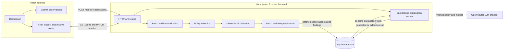
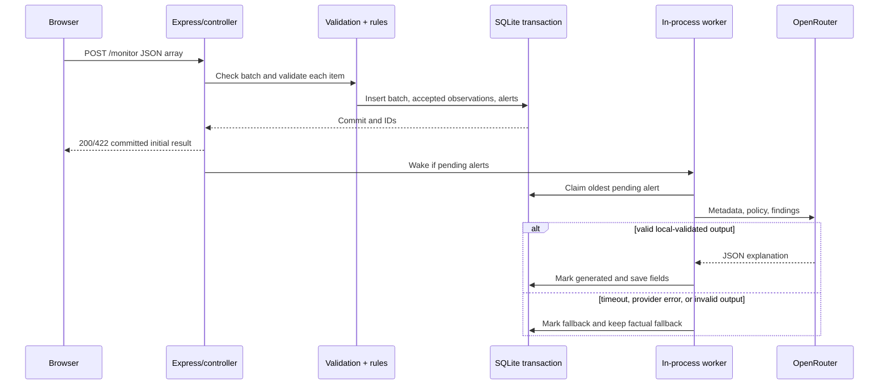
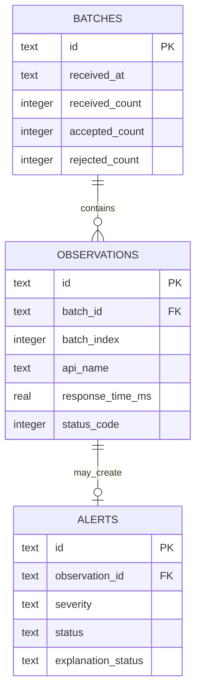
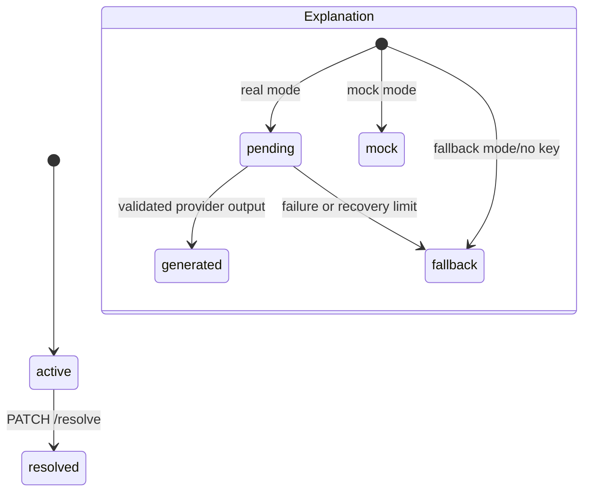

# Architecture: Intelligent API Monitoring & Alert System

## Overview

This application evaluates batches of submitted API observations and turns rule-detected anomalies into stored alerts. An observation contains an API name, response time, HTTP status, and an optional records-returned count. It is **not** an active API-monitoring service: there is no scheduler, external API polling client, uptime probe, or webhook receiver in the implementation.

Detection is deliberately deterministic. Server-side policies select thresholds and whether records are expected; rules then create the findings and severity that are persisted. An LLM may add a concise explanation and suggested operational checks after the alert is stored. That output is assistance for investigation, not verified root-cause analysis: the prompt forbids inventing causes, and the model cannot change findings, severity, or the alert lifecycle.

The React dashboard submits observations, shows indexed validation feedback, lists and filters stored alerts, shows full evidence and explanation state, and resolves alerts after an investigation. Its “Backend connected” indicator checks this application and SQLite only; it does not mean any external API is healthy.

## Components

| Component | Responsibility | Source |
| --- | --- | --- |
| React/Vite dashboard | Submit batches, list/filter/page alerts, show details, resolve alerts, and poll pending explanation state | [frontend/src/pages/DashboardPage.jsx](../frontend/src/pages/DashboardPage.jsx), [frontend/src/components/SubmitDialog.jsx](../frontend/src/components/SubmitDialog.jsx), [frontend/src/components/AlertDialog.jsx](../frontend/src/components/AlertDialog.jsx) |
| HTTP API | Request IDs, CORS, JSON-size/parsing errors, route registration, health endpoint, and shutdown | [backend/src/app.js](../backend/src/app.js), [backend/src/routes.js](../backend/src/routes.js), [backend/src/server.js](../backend/src/server.js) |
| Controllers and validation | Enforce batch and item boundaries, preserve original item indexes, validate alert query parameters, and shape responses | [backend/src/controllers/monitorController.js](../backend/src/controllers/monitorController.js), [backend/src/controllers/alertController.js](../backend/src/controllers/alertController.js), [backend/src/validation.js](../backend/src/validation.js) |
| Detection and policy selection | Merge default and exact API-name overrides, create deterministic findings/severity, and make factual fallback text | [backend/src/services/monitorService.js](../backend/src/services/monitorService.js), [backend/src/services/detection.js](../backend/src/services/detection.js), [backend/src/config.js](../backend/src/config.js) |
| SQLite model | Apply numbered migrations; transact batches, observations, and alerts; query/resolve alerts; claim/update explanation work | [backend/src/models/monitorModel.js](../backend/src/models/monitorModel.js), [backend/migrations/001_initial.sql](../backend/migrations/001_initial.sql), [backend/migrations/002_background_explanations.sql](../backend/migrations/002_background_explanations.sql) |
| Explanation service and worker | Build/validate provider requests, bound calls, persist final explanation states, and recover pending work at startup | [backend/src/services/explanation.js](../backend/src/services/explanation.js), [backend/src/services/explanationWorker.js](../backend/src/services/explanationWorker.js) |
| External LLM provider | OpenRouter-compatible chat-completions endpoint used through the OpenAI SDK, only in configured real mode | [backend/src/services/explanation.js](../backend/src/services/explanation.js) |

## Architecture diagram


The application has three main parts: a React frontend, a Node.js and Express backend, and a SQLite database. The backend also integrates with an LLM through OpenRouter.

The frontend submits observations and lets users filter alerts, inspect evidence, and resolve them. The backend validates input, applies detection policies, stores observations and alerts, and manages explanations. SQLite preserves batches, observations, findings, alert status, and explanation results across restarts.

An important boundary is that this application evaluates submitted observations. It does not independently poll external APIs.

Detection uses deterministic rules. For example, a response above the configured latency threshold produces a slow-response finding, while HTTP 500 produces a server-failure finding. The LLM receives those findings and supporting metrics. It does not control severity or decide whether an anomaly exists.

After ingestion commits, the API responds immediately. A background worker reads pending explanation work from SQLite and calls the provider within a configured concurrency limit. The dashboard refreshes pending explanations until they reach a final state.

The worker and API share one Node.js process and one SQLite file. The database is also the worker’s durable source of pending rows; it is not an external queue or distributed coordinator.

## `POST /monitor` request flow

### What the handler waits for

`POST /monitor` does **not** wait for real LLM generation. The commit boundary is the return of the SQLite transaction in `saveBatch`: the `batches` row, every accepted `observations` row, and each corresponding `alerts` row are written atomically before the controller assembles its response. In OpenRouter mode, anomalous alerts are committed as `pending`; the handler calls `res.json(...)` and then wakes the worker. Thus the response represents committed ingestion and initial explanation state, not completed generation. In fallback and mock modes there is no background provider call, so the initial explanation status is already final.

1. Express assigns a request ID, applies CORS, and parses strict JSON with a 64 KB limit. Malformed JSON is `400`; an oversized body is `413`.
2. The monitor controller requires a JSON array of 1 through 100 elements. A structural failure returns `422 INVALID_BATCH` before a batch row is created.
3. Each element is independently parsed by the strict Zod observation schema. Valid values are normalized (including trimmed `api_name`); invalid values stay out of persistence. The response includes each rejection’s original zero-based index and field errors.
4. For each accepted observation, the service merges the default policy with an exact, case-sensitive `API_POLICIES_JSON` match for the trimmed API name. The default is `responseTimeThresholdMs: 3000` and `expectRecords: true`.
5. Rules create findings: HTTP 500–599 is critical `SERVER_FAILURE`; HTTP 400–499 is warning `CLIENT_ERROR`; response time strictly above its threshold is warning `SLOW_RESPONSE`; and, when records are expected, zero or absent counts are warning findings. Any critical finding makes the alert critical; otherwise a nonempty finding list makes it warning. One anomalous observation creates one alert containing all its findings.
6. The service builds a factual fallback message from the API name and finding descriptions. This is stored before a provider call.
7. One SQLite transaction inserts the batch, all accepted observations, and alerts. The batch stores `received_count`, accepted count, and rejected count even for a fully invalid per-item batch. A transaction error rolls the writes back and reaches the generic error middleware as `500 INTERNAL_ERROR`.
8. The controller combines valid and rejected results in original order. Real OpenRouter-mode alerts are `pending`, and the in-process worker is scheduled only after `res.json` is invoked. The worker claims stored pending rows and later changes explanation data only.
9. A batch with one or more accepted items returns `200`; a fully per-item-invalid batch returns `422` with the saved batch ID and indexed feedback. The initial explanation counts are a snapshot and can change later.



The diagram shows the application’s ordering guarantee: response assembly/end is initiated before background generation. A network client may receive bytes later, but no provider completion is awaited by the ingestion handler.

## Data model and lifecycle



The tables are created by [migration 001](../backend/migrations/001_initial.sql); [migration 002](../backend/migrations/002_background_explanations.sql) adds background-work fields.

- `batches` records receipt time and counts for every batch that passes the outer array boundary, including a batch where every individual item is invalid.
- `observations` stores only accepted items. `UNIQUE(batch_id, batch_index)` preserves their position in the original input. It also snapshots the effective policy (`response_time_threshold_ms`, `expect_records`) used at detection time, so later configuration changes do not rewrite historical evidence.
- `alerts` has a unique `observation_id`, so an accepted observation has zero alerts when healthy or exactly one alert when anomalous. Findings and suggested checks are stored as JSON text. Severity is constrained to `warning` or `critical`; lifecycle status is constrained to `active` or `resolved`; explanation status is constrained to `pending`, `generated`, `fallback`, or `mock`.
- Indexes support active/severity recency lists, exact API-name filtering, batch lookup, and pending-work selection. Queries order alerts by `created_at DESC, id DESC`.

`received_at` is the batch receipt timestamp. Accepted observations use `created_at`; alerts use `created_at` and `updated_at`. `resolved_at` is set only on the first successful resolve and stays unchanged on repeated resolution. `explanation_claimed_at` and `explanation_attempts` are worker bookkeeping rather than alert lifecycle fields. A claim, recovery fallback, explanation update, or resolution changes alert `updated_at`.

Alert lifecycle and explanation lifecycle are independent:



A resolved alert can still receive a generated explanation: the worker update filters on `explanation_status = 'pending'`, not alert `status`. Conversely, resolving never alters explanation status. SQLite file data, migrations, alert rows, and final explanations survive normal restarts when a file path—not `:memory:`—is configured.

## AI behavior and reliability

### Modes, input, and output

`LLM_MODE` supports `openrouter`, `mock`, and `fallback`. `openrouter` without `OPENROUTER_API_KEY` is intentionally treated as fallback mode. Mock mode stores a clearly prefixed `MOCK EXPLANATION` and does not call a provider. Fallback mode stores only the deterministic `fallback_message`; `ai_summary`, provider, and model remain null.

In real mode, [the OpenAI SDK adapter](../backend/src/services/explanation.js) sends a chat-completions request to OpenRouter with only:

- trimmed API identifier;
- `response_time_ms`, `status_code`, and `records_returned` (or `null` when absent);
- the effective policy snapshot; and
- deterministic findings.

The accepted observation schema has no request body or patient payload field. The system prompt treats API names and all supplied values as untrusted data rather than instructions, asks for observed evidence and qualified possibilities only, forbids HTML/executable content, and prohibits changing findings/severity/lifecycle. This is prompt guidance, not proof that a provider response is factually correct; UI strings are rendered as text.

Most models request strict JSON-schema output. The configured special case `minimax/minimax-m3.1-flash:free` instead requests JSON-object mode because the code notes it does not enforce JSON schema. Both paths locally parse JSON and validate it with Zod: `summary` is trimmed and 1–500 characters; `suggested_checks` has 1–4 trimmed strings of 1–160 characters. A local unsafe-markup pattern rejects tags, `javascript:`, HTML data URLs, code fences, and script-like output. The provider request has `max_completion_tokens: 1200`; that is a provider output-token cap, separate from the stored field limits.

### Timeouts and bounded work

Each app process creates one explainer limiter. `LLM_CONCURRENCY` (1–20, default 3) constrains active provider calls across the worker’s claimed alerts and therefore across all batches handled by that process. The worker also starts no more than that many active jobs. This is not a shared limit across processes or machines.

`LLM_TIMEOUT_MS` (100–60,000, default 8,000) is used for both waiting for a limiter slot and the provider call. On call timeout the abort signal is triggered. A provider promise that ignores/has not completed after abort keeps its limiter slot until it settles, avoiding a concurrency breach but potentially reducing throughput. Provider transport errors, empty/truncated output, invalid JSON, schema/markup validation failures, and timeouts produce `fallback`; the factual fallback is already stored and remains visible.

The worker may update only `ai_summary`, suggested checks, explanation status, provider/model metadata, claim bookkeeping, and `updated_at`. It does not modify findings, severity, alert `status`, or `resolved_at`.

### Persisted worker and recovery

In real mode, the worker wakes at startup and after ingestion, then claims the oldest unclaimed pending row in a short database transaction. Claiming increments `explanation_attempts`, writes `explanation_claimed_at`, and supplies the persisted observation, policy, and findings to the explainer. On a normal result, it stores `generated` or `fallback` and clears the claim.

At startup, fallback/mock mode converts any leftover `pending` rows to `fallback`. In real mode, a pending row with fewer than two attempts has its claim cleared for one retry; a row with two or more attempts becomes fallback. This is limited, local recovery—neither an exactly-once guarantee nor a durable general-purpose retry queue.

If a provider call succeeds but the database update fails, the worker logs the failure and leaves the row pending and claimed. A later restart can clear the claim and retry if the attempt limit permits, so the provider might be called again. If the process ends during generation, the row is likewise visible as pending until recovery decides to retry or fall back. On `SIGINT`/`SIGTERM`, the server stops accepting connections, stops worker scheduling, and waits for active jobs along with server close up to `SHUTDOWN_GRACE_MS`; the forced shutdown timer can terminate remaining work.

## Frontend integration

The dashboard uses [one fetch client](../frontend/src/services/api.js). In development, [Vite configuration](../frontend/vite.config.js) proxies `/monitor`, `/alerts`, and `/health` to `DEV_BACKEND_URL` or `http://127.0.0.1:3000`; alternatively a build can use public `VITE_API_BASE_URL`. No provider credential belongs in a `VITE_*` variable.

On load and manual Refresh, the UI checks `/health` and fetches active alerts. It supports the API’s exact API-name filter, status, severity, 20-item pages, server-provided total, details, and resolution. List/detail requests use abort signals and version checks to avoid stale results overwriting newer selection/filter state. Resolution waits for `PATCH /alerts/:id/resolve` success before changing the visible list; an active-only list removes the alert locally and refreshes.

The submission dialog accepts pasted JSON or a local `.json` file, applies client-side JSON/top-level-array/count/64-KB checks, but lets server item validation remain authoritative. It maps server zero-based indexes to “Item 1” style labels while retaining the original index. A `422` batch response with `results` is displayed as feedback rather than discarded as a generic error. Loading a sample only fills the editor.

After a pending batch result, the dialog polls `GET /alerts?status=all&batch_id=...` roughly every three seconds while the page is visible; it stops when every batch alert becomes final or a poll fails. The main page similarly refreshes while a currently visible alert/detail is pending and stops when no visible pending state remains or a fetch fails. A 30-second POST timeout treats a network failure as uncertain rather than retrying automatically, because ingestion may already have committed; the UI tells the user to refresh alerts first. GET/list failures are shown while retaining existing data where available.

Explanation labels distinguish “AI-generated explanation,” “Rule-based explanation,” “Demo explanation,” and “Explanation pending.” Pending and fallback views show `fallback_message`, so the dashboard never needs to wait for AI output to display the deterministic evidence. A successful backend-health check is explicitly labelled as application/database availability only, not external API health.

## Failure scenarios and current trade-offs

| Scenario | Implemented behavior | Remaining limitation |
| --- | --- | --- |
| Invalid input | Malformed JSON is 400; over-64-KB body is 413; invalid outer batch is 422. Per-item-invalid batches store a count-only batch and return indexed 422 feedback; mixed batches process valid items. | No partial-item persistence for rejected input by design. |
| Database failure before commit | The `saveBatch` transaction rolls back; error middleware returns 500 with a request ID. | The client cannot infer whether an interrupted network request committed; it must inspect alerts. |
| Provider timeout or invalid output | Timeout/abort, provider error, empty/truncated response, invalid JSON/schema, or unsafe text becomes `fallback`; factual text remains. | There is no alternate model or automatic later retry after a normal provider failure. |
| Process interruption during generation | A committed alert remains pending; real-mode startup clears one interrupted claim for retry, then falls back after the second attempt. | Recovery is local to this SQLite/process model and not exactly once. |
| Provider success, then DB update failure | The error is logged; the alert stays pending/claimed. Restart recovery may claim it again and call the provider again. | A duplicate provider call is possible; an in-process failure does not immediately clear the claim. |
| Browser disconnect after ingestion | Server-side ingestion can still have committed. The frontend treats timed-out/disconnected POST as uncertain and avoids automatic retry. | No idempotency key or lookup-by-client submission token. |
| Concurrent batches | SQLite transactions atomically persist each batch; WAL and a 5-second busy timeout are configured. The process-wide worker limit bounds provider calls. | SQLite and claims are designed for one local process, not multi-instance coordination. |

The implementation chooses JavaScript and Express for a compact request/service/model layout, SQLite for a local durable assessment database with simple transactions, and deterministic rules for auditable severity. The LLM is kept downstream of those rules so an unavailable or misleading explanation cannot create, suppress, or reprioritize an alert. The execution model is one Node process with an in-process worker rather than a separate queue consumer.

Current limits are appropriate for a local demo: no authentication, authorization, TLS termination, rate limiting, external API polling, alert grouping/deduplication, distributed workers, or external queue. Move to PostgreSQL when measured concurrent writers, database lock contention, database size/backup needs, or multi-instance deployment exceed SQLite’s local-file model. Split the worker when provider latency/backlog materially affects the web process or operational isolation is required. Add a durable external queue when work needs multi-process ownership, delayed/backoff retries, independently scalable consumers, or stronger delivery/audit guarantees.

## Concrete assessment example

The checked-in environment example sets `API_POLICIES_JSON={}`, so the applicable default policy for `AppointmentAPI` is a 3000 ms threshold with records expected. For this submitted observation:

```json
{
  "api_name": "AppointmentAPI",
  "response_time_ms": 5500,
  "status_code": 500,
  "records_returned": 0
}
```

the code creates three findings:

- `SERVER_FAILURE` / critical — HTTP 500 is a server failure.
- `SLOW_RESPONSE` / warning — 5500 ms is above 3000 ms.
- `UNEXPECTED_EMPTY_RESULT` / warning — zero records were returned where records are expected.

The overall severity is `critical`, because any critical finding wins. With `LLM_MODE=openrouter` and a server-side key, the committed alert begins as `pending`; with the checked-in fallback default it begins as `fallback`. This is a representative persisted alert shape (IDs and timestamps are illustrative):

```json
{
  "id": "alert-uuid",
  "observation_id": "observation-uuid",
  "severity": "critical",
  "status": "active",
  "findings": [
    { "code": "SERVER_FAILURE", "severity": "critical", "observed": 500, "expected": "HTTP status below 500" },
    { "code": "SLOW_RESPONSE", "severity": "warning", "observed": 5500, "expected": "<= 3000 ms" },
    { "code": "UNEXPECTED_EMPTY_RESULT", "severity": "warning", "observed": 0, "expected": "At least 1 record" }
  ],
  "fallback_message": "AppointmentAPI: HTTP 500 is a server failure. Response time 5500 ms exceeds 3000 ms. No records were returned although records are expected.",
  "ai_summary": null,
  "suggested_checks": null,
  "explanation_status": "pending",
  "provider": null,
  "model": null,
  "observation": {
    "batch_id": "batch-uuid",
    "batch_index": 1,
    "api_name": "AppointmentAPI",
    "response_time_ms": 5500,
    "status_code": 500,
    "records_returned": 0,
    "effective_policy": { "responseTimeThresholdMs": 3000, "expectRecords": true }
  }
}
```

The corresponding initial result entry is `{ "index": 1, "status": "alert", "severity": "critical", "explanation_status": "pending", ... }`; it appears with `200` when the batch also contains at least one valid item. If an AI explanation is generated later, only explanation-related fields change. For example only—not a recorded provider response—an AI summary could say: “HTTP 500, high latency, and no returned records were observed; inspect the request path, server logs, and downstream dependencies.”

## Test evidence and verification status

Relevant automated tests include:

- [backend/test/monitor.test.js](../backend/test/monitor.test.js): rule thresholds/classification, mixed and fully invalid batches, filtering/pagination, idempotent resolution, SQLite reopening, provider failure/fallback, provider protocol validation, async timing, recovery, and bounded concurrency.
- [frontend/src/App.test.jsx](../frontend/src/App.test.jsx): dashboard loading/error/empty states, filters, resolution behavior, submission feedback, pending polling, uncertain POST, and dialog keyboard interaction.
- [frontend/src/App.e2e.test.jsx](../frontend/src/App.e2e.test.jsx) with [backend/test/e2eServerWorker.js](../backend/test/e2eServerWorker.js): a real local Express/SQLite/UI flow using a controlled provider stub.
- [frontend/src/services/api.test.js](../frontend/src/services/api.test.js): non-JSON proxy failure handling.

These tests use stubbed/local providers and temporary SQLite databases; they do not establish that a live provider is available today. During this documentation task, I inspected the test code but did not run the test suites, type check, or builds, because this task changes documentation only. The repository scripts are [backend package scripts](../backend/package.json) and [frontend package scripts](../frontend/package.json); use them to record a fresh execution result rather than relying on historical counts.


